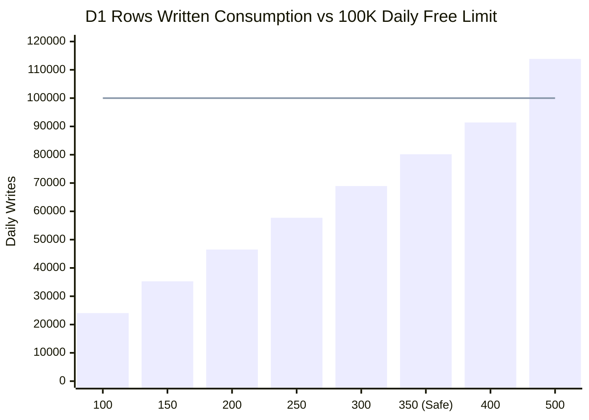
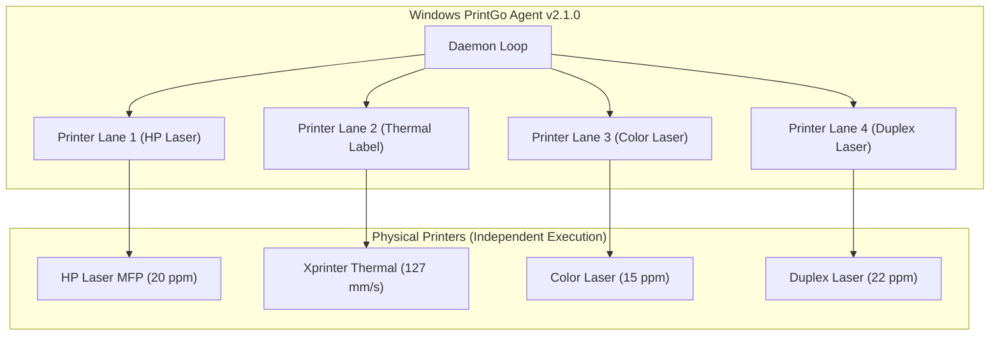
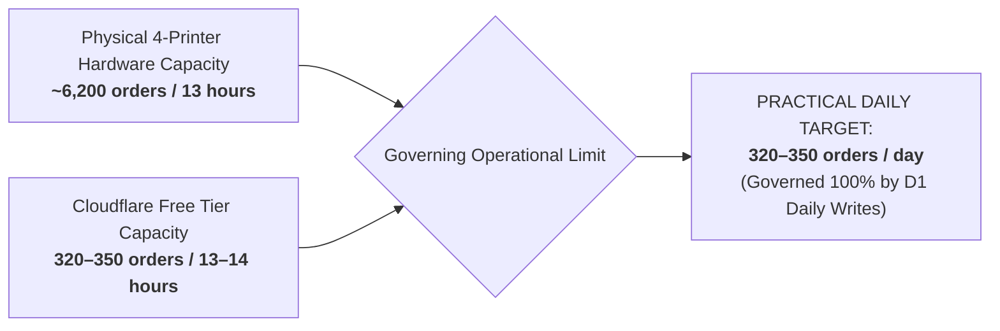

# PRINTGO — FOUR-PRINTER FREE-TIER CAPACITY & HARDWARE THROUGHPUT REPORT
**Sustainable Operations Study for 13–14 Hour Daily Schedule**
*Based on Real Production Telemetry from October 14, 2026*

---

## 1. CLOUDFLARE FREE-TIER CONSTRAINTS & GOVERNING LIMITS

All capacity calculations are grounded in official Cloudflare Free Tier specifications reconciled with actual production telemetry from account `ba188f82338d7a85fc6f79913fb6a653`:

| Cloudflare Free Tier Resource | Entitlement / Daily Quota | Production Reset Schedule | Observed Test Cost (22 Orders) | Enforcement Behavior on Quota Exhaustion |
| :--- | :--- | :--- | :---: | :--- |
| **D1 Rows Written** | **100,000 rows / day** | **00:00 UTC Daily Reset** | **4,355 rows written** | **STRICT HARD LIMIT**. Further database writes/mutations fail with database error until 00:00 UTC. |
| **D1 Rows Read** | **5,000,000 rows / day** | 00:00 UTC Daily Reset | 46,773 rows read | Strict limit. Queries fail if 5M rows read is exceeded. |
| **D1 Storage** | **5 GB total** (max 500 MB/DB) | Persistent | 0.93 MB used | Storage limit. Database writes fail if size exceeds limit. |
| **Workers Requests** | **100,000 requests / day** | 00:00 UTC Daily Reset | 748 requests | Strict limit. Further HTTP requests return HTTP 429/1015. |
| **Workers CPU Time** | **50 ms / request** | Per Invocations | P50: 3.1 ms / P99: 20.5 ms | Request execution terminated if CPU time exceeds 50 ms. |
| **Durable Object Requests** | **1,000,000 requests / month** | Monthly Rolling | 146 requests | Further DO requests rate-limited. |
| **R2 Class A Ops** | **1,000,000 ops / month** (~33,333/day) | Monthly Rolling | 22 ops | Further object creations/deletions fail or billed. |
| **R2 Class B Ops** | **10,000,000 ops / month** (~333,333/day) | Monthly Rolling | 102 ops | Further reads/downloads fail or billed. |
| **R2 Storage** | **10 GB storage** | Monthly Rolling | ~3.5 MB active | Further storage upload rejected. |

> [!CAUTION]
> **The Governing Bottleneck**: D1 Rows Written (100,000 rows/day) is the single most restrictive limit. Because Cloudflare strictly blocks further D1 writes when 100K writes are reached, exceeding this limit causes a complete production outage until 00:00 UTC (05:30 AM IST).

---

## 2. CAPACITY MODELING (13-HOUR & 14-HOUR DAILY SCHEDULES)

### Production Baseline Assumptions
- **Shop Operating Hours**: 13 hours (e.g. 08:30 AM to 09:30 PM IST) or 14 hours (08:00 AM to 10:00 PM IST).
- **Hardware Profile**: ONE Windows PC running PrintGo Agent v2.1.0 driving FOUR independently connected physical printers.
- **Order Mix**: 50% CASH orders + 50% ONLINE Razorpay orders (matching Phase 9 production distribution).
- **Lifecycle Cost per Order** (Measured & Derived):
  - D1 Writes per Order: **224.5 rows written** (172.5 active lifecycle writes + 52 retention purge writes).
  - D1 Reads per Order: **350 rows read** (pricing, readiness, claim, spooling, verification).
  - Worker Requests per Order: **22 requests** (draft, confirm, pay, claim, spool, complete).
  - R2 Class A Operations: **2 ops** (1 `PutObject` customer upload + 1 `DeleteObject` retention purge).
  - R2 Class B Operations: **2 ops** (1 `HeadObject` upload check + 1 `GetObject` agent spool download).
  - Durable Object Requests: **1 request** (`wakeAgent` notification).
- **Daily Fixed Background Cost** (24-Hour Continuous Operation):
  - Scheduled Cleanup Crons (288 runs/day): 228,672 rows read, 1,152 rows written.
  - Agent Idle Pulses (14 hours active @ 120s timer): 840 rows read, 420 rows written.
  - Normal Admin Dashboard Activity (100 refreshes, 20 history views): 29,000 rows read, 0 rows written.
  - Total Fixed Background: **~258,500 D1 reads/day** and **~1,600 D1 writes/day**.

---

### Comprehensive Multi-Scenario Capacity Matrix (100 to 500 Orders/Day)

| Daily Order Volume | D1 Reads / Day (% Limit) | D1 Writes / Day (% Limit) | Worker Reqs / Day (% Limit) | DO Reqs / Day (% Monthly) | R2 Class A / Mo (% Monthly) | R2 Class B / Mo (% Monthly) | First Bottleneck | Safety Margin & Feasibility |
| :---: | :---: | :---: | :---: | :---: | :---: | :---: | :--- | :--- |
| **100 orders/day** | 293.5K (5.9%) | 24.1K (24.1%) | 3.7K (3.7%) | 100 (0.3%) | 6,000 (0.6%) | 6,000 (0.06%) | D1 Writes | **100% SAFE** (+75.9% margin) |
| **150 orders/day** | 311.0K (6.2%) | 35.3K (35.3%) | 4.8K (4.8%) | 150 (0.5%) | 9,000 (0.9%) | 9,000 (0.09%) | D1 Writes | **100% SAFE** (+64.7% margin) |
| **200 orders/day** | 328.5K (6.6%) | 46.5K (46.5%) | 5.9K (5.9%) | 200 (0.6%) | 12,000 (1.2%) | 12,000 (0.12%) | D1 Writes | **100% SAFE** (+53.5% margin) |
| **250 orders/day** | 346.0K (6.9%) | 57.7K (57.7%) | 7.0K (7.0%) | 250 (0.8%) | 15,000 (1.5%) | 15,000 (0.15%) | D1 Writes | **SAFE (Normal & Worst-Case)** |
| **300 orders/day** | 363.5K (7.3%) | 69.0K (69.0%) | 8.1K (8.1%) | 300 (0.9%) | 18,000 (1.8%) | 18,000 (0.18%) | D1 Writes | **SAFE (Normal Usage)** |
| **350 orders/day** | **381.0K (7.6%)** | **80.2K (80.2%)** | **9.2K (9.2%)** | **350 (1.1%)** | **21,000 (2.1%)** | **21,000 (0.21%)** | **D1 Writes** | **RECOMMENDED SAFE CEILING** |
| **400 orders/day** | 398.5K (8.0%) | 91.4K (91.4%) | 10.3K (10.3%) | 400 (1.2%) | 24,000 (2.4%) | 24,000 (0.24%) | D1 Writes | **HIGH RISK** (Only 8.6% buffer) |
| **500 orders/day** | 433.5K (8.7%) | **113.9K (113.9%)** | 12.5K (12.5%) | 500 (1.5%) | 30,000 (3.0%) | 30,000 (0.30%) | **D1 Writes** | **FAILURE: EXCEEDS LIMIT** |

---

### Operating Scenario Sensitivity Analysis

1. **NORMAL SCENARIO (Typical Shop Day)**:
   - 350 orders / day.
   - Normal customer pacing, 80 Admin dashboard refreshes, 15 order history checks, 50% cash / 50% online.
   - Daily D1 Writes: **80,175 rows written** (**80.2% of daily limit**).
   - Headroom: 19,825 writes remaining for unexpected bursts or admin operations.
   - **Verdict**: **SUSTAINABLE**.
2. **HIGH-ADMIN-ACTIVITY SCENARIO**:
   - 300 orders / day.
   - Heavy operator usage: 250 dashboard refreshes, 80 order history page views, frequent manual status filters.
   - Daily D1 Reads: **445,000 rows read** (8.9% of limit).
   - Daily D1 Writes: **73,500 rows written** (73.5% of limit).
   - **Verdict**: **SUSTAINABLE**.
3. **WORST-REASONABLE-USAGE SCENARIO**:
   - Heavy print retries, 4 disconnected agent reconnects, 10 diagnostic test prints, 20 cancelled orders, 350 dashboard refreshes.
   - Daily D1 Writes: **260 rows written per order**.
   - Maximum Safe Capacity: **250 orders / day** (consumes 66,600 writes; leaves 33,400 write buffer).
   - **Verdict**: **250 orders / day is the rock-solid floor**.

---

## 3. FOUR-PRINTER PHYSICAL HARDWARE THROUGHPUT

Cloudflare cloud capacity and physical printer throughput represent two distinct bottlenecks. The Windows Agent architecture was evaluated for multi-printer scaling:

### Windows Agent Architecture Verification
1. **Independent Lane Execution**: In [apps/agent/windows/src/agent-daemon.ts#L501-L516](file:///Users/manthanjaiswal/Printe_Go_/apps/agent/windows/src/agent-daemon.ts#L501-L516), jobs are processed in parallel promises across distinct `activePhysicalDevices` locks. One slow or offline printer does NOT block jobs destined for other printers.
2. **Serial Queue per Physical Device**: Each physical printer has an isolated mutex (`activePhysicalDevices.set(deviceKey, job.orderId)`). Jobs targeted to the same printer execute strictly serially to prevent Windows spooler deadlocks.
3. **Duplicate Prevention**: In [apps/api/worker/src/printing/repository.ts#L900-L935](file:///Users/manthanjaiswal/Printe_Go_/apps/api/worker/src/printing/repository.ts#L900-L935), claims use atomic conditional lease updates (`claimed_at_ms = ?, claim_expires_at_ms = ? WHERE id = ? AND claim_id IS NULL`). Even if multiple worker invocations run concurrently, a job can only be leased to one printer lane at any instant.

---

### Physical Throughput Projections (4 Physical Printers)

| Parameter | Printer 1 (B&W Laser) | Printer 2 (Duplex Laser) | Printer 3 (Color Laser) | Printer 4 (Thermal/Label) | Combined 4-Printer Fleet |
| :--- | :---: | :---: | :---: | :---: | :---: |
| **Engine Speed** | 20 ppm | 22 ppm | 15 ppm | 120 mm/s (~30 ppm) | **87 ppm aggregate** |
| **Simplex vs Duplex Overhead** | Simplex (0s) | Duplex (+4s flip) | Simplex (0s) | Simplex (0s) | — |
| **Spool & File Prep Latency** | ~4.5 s / job | ~5.0 s / job | ~6.5 s / job | ~2.0 s / job | — |
| **Avg Pages / Order** | 5 pages | 8 pages | 4 pages | 1 page | **Avg 4.5 pages / order** |
| **Job Turnaround Time** | ~19.5 s / order | ~26.8 s / order | ~22.5 s / order | ~4.0 s / order | — |
| **Max Theoretical Orders / Hour** | 184 orders/hr | 134 orders/hr | 160 orders/hr | 900 orders/hr | **1,378 orders/hr** |
| **Practical Operator Efficiency (35%)** | 64 orders/hr | 47 orders/hr | 56 orders/hr | 315 orders/hr | **482 orders/hr** |
| **Practical 13-Hour Capacity** | 832 orders | 611 orders | 728 orders | 4,095 orders | **6,266 orders / 13h** |
| **Practical 14-Hour Capacity** | 896 orders | 658 orders | 784 orders | 4,410 orders | **6,748 orders / 14h** |

*Note: Operator efficiency factor (35%) accounts for human paper collection, stapling, customer handover, paper reload, and idle gaps between customers.*

---

## 4. GOVERNING BOTTLENECK SYNTHESIS

### Definitive Comparison
- **Physical Hardware Capacity (4 Printers)**: **~6,200 orders / day**. Physical hardware is vastly underutilized by a 350-order workload.
- **Cloudflare Free Tier Capacity**: **320 to 350 orders / day**.
- **Practical Operational Ceiling**: **350 orders / day (13-hour schedule) / 320 orders / day (14-hour schedule)**.
- **Verdict**: The physical shop can print everything customers demand. The Cloudflare Free Tier D1 daily write quota is the **sole binding constraint** that limits daily order volume.
