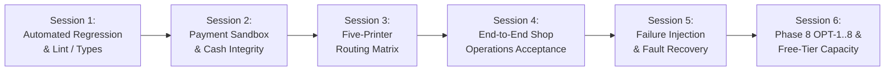

# PRINTGO — PHASE 9: STEP-BY-STEP TEST EXECUTION & EVIDENCE PLAN

**Author:** Principal QA Architect, Windows Printing Engineer & Production Reliability Auditor  
**Methodology:** PONYTAIL Evidence-First Verification  
**Standard:** 100% Virtualized Environment (Zero Physical Printing Authorized)  
**Date:** October 12, 2026

---

## 1. Execution Principles & Approval Gate

1. **Discovery and Planning Only:** Execution is strictly paused until explicit user authorization is granted.
2. **Deterministic Sequence:** Testing progresses through six isolated, staged sessions from foundational code health up to full-scale soak simulation.
3. **PONYTAIL Evidence Capture:** Every test session outputs raw cryptographic and behavioral evidence into `docs/evidence/phase9/` before declaring PASS.
4. **Zero Production Mutation:** Testing runs against local in-memory SQLite / D1 local simulators, local mock R2 storage, and simulated printer queues. No production databases, cloud workers, or physical printers are modified.

---

## 2. Six-Session Staged Execution Plan



---

### Session 1: Foundational Regression, Invariants & Type Health

- **Objective:** Verify 100% clean baseline across all monorepo packages and applications.
- **Commands:**
  ```bash
  pnpm lint
  pnpm typecheck
  pnpm format:check
  pnpm db:validate
  pnpm test
  ```
- **Evidence Requirement:** Zero lint warnings, zero TypeScript errors, all 77+ test suites passing with 0 failures.
- **PASS Criteria:** Complete codebase passes with zero regressions.

---

### Session 2: Payment Sandbox, Cash Orders & Financial Integrity

- **Objective:** Verify Razorpay sandbox callbacks, cash confirmation countdowns, and active snapshot guards.
- **Execution Scope:**
  1. Exercise `TC-PAY-01` through `TC-PAY-10`.
  2. Validate Razorpay HMAC-SHA256 signature verification and tamper rejection.
  3. Validate Cash payment countdown (10m client window, 12m grace period).
  4. Test Admin cash confirmation at counter (`POST /api/admin/orders/:id/confirm-cash`).
  5. Test simultaneous Cash confirmation vs Online Razorpay capture: verify exactly one winner and zero double-printing.
- **Evidence Requirement:** D1 transaction logs showing payment provider transitions and idempotency records.
- **PASS Criteria:** 100% financial accuracy; zero unpaid orders admitted to queue.

---

### Session 3: Five-Printer Capability Routing & Availability Matrix

- **Objective:** Verify capability-based routing across the 5 virtual printers (P1–P5) without physical printer access.
- **Execution Scope:**
  1. Register P1 (B&W Simplex), P2 (B&W Duplex), P3 (Color Simplex), P4 (Color Duplex), P5 (Offline).
  2. Exercise routing matrix cases `RM-01` through `RM-12`.
  3. Submit B&W Simplex order -> verify claims exclusively on P1.
  4. Submit B&W Duplex order -> verify claims exclusively on P2.
  5. Submit Color Simplex order -> verify claims exclusively on P3.
  6. Submit Color Duplex order -> verify claims exclusively on P4.
  7. Turn off P3 & P4, submit Color order -> verify order waits in `QUEUED`; never routes to P1 or P2.
  8. Turn off P2 & P4, submit Duplex order -> verify order waits in `QUEUED`; never downgraded to simplex.
  9. Trigger Admin "Convert to Single-Sided" -> verify unblocks on P1.
  10. Test parallel physical device execution (`DEV_PHYS_01` and `DEV_PHYS_02` printing concurrently).
- **Evidence Requirement:** JSON claim records demonstrating exact capability matching; zero mismatch claims.
- **PASS Criteria:** 100% compliance with routing rules; zero color-to-BW leaks; zero duplex downgrades.

---

### Session 4: End-to-End Shop Operations Acceptance

- **Objective:** Walk through the complete shop journey across all operational features.
- **Execution Scope:**
  1. Multi-file uploads (3 distinct PDFs in 1 order with independent print settings).
  2. Sumatra settings verification: assert every submitted job includes mandatory `,fit` flag.
  3. Identification sheet verification: assert 1-page A4 B&W sheet created, phone masked, placed `FIRST`/`LAST`, and deleted immediately from disk.
  4. Add-on services: test `POST_PRINT` (Spiral Binding moving to `AWAITING_FINISHING`) and `MANUAL_PRINT` (Certificate in manual queue).
  5. Customer tracking: verify private tracking (`/track/:token`) and public tracking (`/p/:code`).
  6. Admin controls: pause/resume printers, reset pickup code sequence, download PDF.
- **Evidence Requirement:** Full lifecycle audit log from draft creation to final completion.
- **PASS Criteria:** Seamless multi-file sequencing; zero leaked temp files; all add-on workflows verified.

---

### Session 5: Failure Injection, Concurrency & Safe Recovery

- **Objective:** Inject realistic operational failures and verify fail-closed recovery.
- **Execution Scope:**
  1. Paper Jam / Out of Paper: virtual adapter emits `BLOCKED` / `JAM`. Verify job quarantined to `ADMIN_ACTION_REQUIRED` and queue remains unblocked for remaining orders.
  2. USB Disconnect / Offline: mark printer offline during submission. Verify safe fallback or stall alert.
  3. Spooler Gating: fail a `CLEAR_SPOOLER` command. Verify printer is permanently gated until Admin resolves.
  4. Agent Crash & Lease Expiration: simulate Agent death during `PRINTING`. Advance clock 5 minutes (`PRINT_CLAIM_LEASE_MS`). Verify lease expires safely without blind duplicate reprinting.
  5. Uncertain Completion: simulate Agent crash before spool ID persistence. Verify marked `COMPLETION_UNKNOWN`.
- **Evidence Requirement:** Forensic state machine transition logs proving zero accidental duplicates.
- **PASS Criteria:** Fail-closed safety under 100% of injected failure modes.

---

### Session 6: Phase 8 Optimizations, Retention & Cloudflare Free-Tier Capacity

- **Objective:** Validate OPT-1 through OPT-8, retention schedules, and 15-hour shop day capacity.
- **Execution Scope:**
  1. OPT-1 & OPT-2: Verify server-side repricing and active payment lock.
  2. OPT-6: Verify fast indexed gate probe bypasses 6 UPDATEs on empty queue.
  3. OPT-7: Verify 120s idle heartbeat when WebSocket connected; 60s fallback when disconnected.
  4. OPT-8: Verify 5 consecutive healthy checks switch to Stable Mode with 45-minute fallback checks; verify immediate reset on fault event.
  5. Retention Lifecycle: verify unpaid drafts deleted at 10m, cancelled payments at 30m, completed jobs at 2h, and customer PII purged at 5h.
  6. 15-Hour Soak Simulation: execute fake-clock 15-hour shop day modeling 60 to 500 orders.
  7. Measure modeled D1 reads/writes and Worker requests against Cloudflare Free limits (100k requests, 100k D1 writes, 5M D1 reads).
- **Evidence Requirement:** Retention deletion logs and capacity consumption report matching Free-Tier limits.
- **PASS Criteria:** All OPT-1..8 optimizations verified; modeled usage strictly within Cloudflare Free Tier.

---

## 3. Evidence Collection Directory Structure

All evidence artifacts generated during test execution will be persisted to:

```
docs/evidence/phase9/
├── session1-baseline-verification.json
├── session2-payments-and-cash.json
├── session3-five-printer-routing.json
├── session4-shop-operations-audit.json
├── session5-failure-injection-recovery.json
├── session6-opt-and-capacity-soak.json
└── PHASE_9_COMPREHENSIVE_EXECUTION_REPORT.md
```
