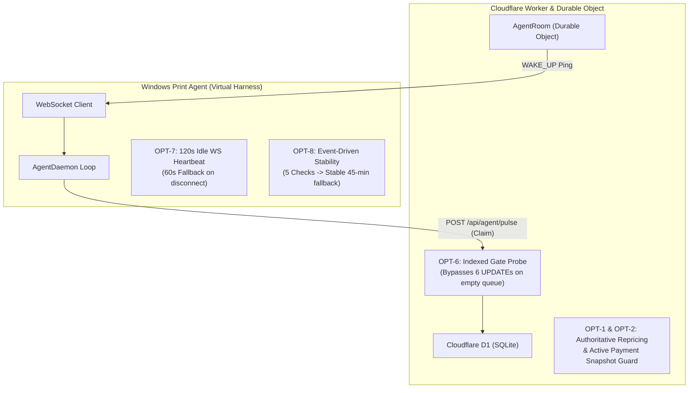
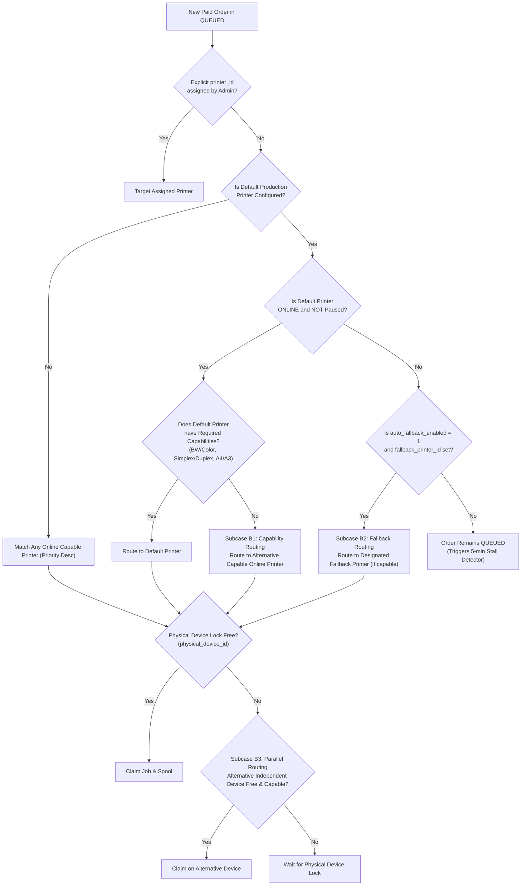

# PRINTGO — PHASE 9: SYSTEM DISCOVERY & CODEBASE ARCHITECTURE AUDIT

**Author:** Principal QA Architect, Windows Printing Engineer & Production Reliability Auditor  
**Methodology:** PONYTAIL Evidence-First Verification  
**Target:** PrintGo V2 Monorepo (Commit `85320ee`)  
**Scope:** Customer PWA, Admin PWA, Cloudflare Worker API, D1 Database, R2 Storage, Windows Agent, Printing Subsystem, Razorpay Integration  
**Date:** October 12, 2026

---

## 1. Executive Summary & Verification Methodology

Under the **PONYTAIL evidence-first methodology**, zero claims are made without tracing executable code, database schemas, and regression tests. This discovery audit documents the exact architectural reality of the PrintGo platform following Phase 8 completion.

### Hard Operational Invariant for Phase 9

> **CRITICAL:** NO PHYSICAL PRINTER IS AVAILABLE OR AUTHORIZED.  
> Under no circumstances may any real print queue, Windows default printer, network printer port (`9100`), or physical spooler destination be targeted. All testing must be conducted against an isolated virtual printer environment with zero paper output and zero physical side effects.

---

## 2. Comprehensive Inventory of Implemented vs Missing Features

| Feature Subsystem                  | Exact Implementation Location                                                                                                                               | Status                           | Implementation Details & Behavioral Reality                                                                                                                                                                                                              |
| :--------------------------------- | :---------------------------------------------------------------------------------------------------------------------------------------------------------- | :------------------------------- | :------------------------------------------------------------------------------------------------------------------------------------------------------------------------------------------------------------------------------------------------------- |
| **Customer QR / Web Entry**        | `apps/web/customer/src/App.tsx`<br>`apps/api/worker/src/customer/routes.ts`                                                                                 | **IMPLEMENTED**                  | Customer scans shop QR or accesses PWA; fetches public config (`GET /api/customer/config`) returning shop name, limits, and service settings.                                                                                                            |
| **PDF Multi-File Upload**          | `apps/api/worker/src/storage/r2-upload-signer.ts`<br>`apps/web/customer/src/FileUpload.tsx`                                                                 | **IMPLEMENTED**                  | Multi-PDF support via private R2 pre-signed PUT URLs. Worker validates PDF header, byte bounds, and MIME type via `HEAD` without buffering customer PDF in Worker memory.                                                                                |
| **PDF Client Validation**          | `apps/web/customer/src/pdf-validator.ts`                                                                                                                    | **IMPLEMENTED**                  | Client parses PDF via `pdfjs-dist` to count pages, detect page dimensions/orientations, and reject corrupted or encrypted files prior to draft creation.                                                                                                 |
| **Server-Side Pricing**            | `packages/pricing/src/index.ts`<br>`apps/api/worker/src/customer/service.ts`                                                                                | **IMPLEMENTED**                  | Fully server-authoritative. Calculates rates based on paper size (A4/A3), color (BW/COLOR), sides (SINGLE/DOUBLE), volume discount bands, priority surcharge, and fixed add-ons. Client prices are never trusted.                                        |
| **Print Settings Options**         | `packages/domain/src/vocabularies.ts`<br>`apps/web/customer/src/PrintOptions.tsx`                                                                           | **IMPLEMENTED**                  | Supports B&W vs Color, Single-Sided vs Double-Sided (Long/Short edge), Copies (1-100), Page Ranges (e.g. `1-5, 8`), Orientation (portrait/landscape), and Paper Size (A4/A3).                                                                            |
| **Fit-to-Page Handling**           | `apps/agent/windows/src/printing/windows-printer-adapter.ts:531`                                                                                            | **IMPLEMENTED (AGENT-SIDE)**     | Hardcoded `fit` parameter automatically appended to SumatraPDF execution string: `"${copies}x,paper=${paperSize},${color},${duplex},fit"`. There is no customer UI toggle; fit-to-page is universally enforced.                                          |
| **Identification Sheets**          | `apps/agent/windows/src/printing/identification-sheet.ts`<br>`database/migrations/0023_identification_sheet_conditions.sql`                                 | **IMPLEMENTED**                  | 1-page A4, B&W, single-sided separator sheet generated locally in OS temp folder via pure PDF generator; phone number masked; placed `FIRST` or `LAST`; deleted immediately after mock/real spooling. Evaluates `id_sheet_min_amount_paise`.             |
| **Razorpay Test-Mode Payment**     | `apps/api/worker/src/payments/service.ts`<br>`apps/api/worker/src/payments/webhook.ts`                                                                      | **IMPLEMENTED**                  | Server creates Razorpay order (`amount_paise`, currency `INR`). Verifies HMAC-SHA256 signature on callback and webhook. Idempotent payment recording prevents double charging or duplicate order claims.                                                 |
| **Cash Payment Flow**              | `apps/api/worker/src/payments/repository.ts`<br>`database/migrations/0029_cash_orders_and_smart_payment.sql`<br>`apps/web/customer/src/CashWaitingPage.tsx` | **IMPLEMENTED**                  | Customer selects Cash (`POST /api/customer/drafts/:token/cash`). 10-minute payment countdown + 2-minute grace period. Order enters `PAYMENT_PENDING`. Admin confirms cash at counter, queuing order.                                                     |
| **Admin Manual Order Queue**       | `apps/web/admin/src/ManualOrdersPage.tsx`<br>`apps/api/worker/src/addon-services/routes.ts`                                                                 | **IMPLEMENTED (QUEUE ONLY)**     | Admin manages orders requiring `MANUAL_PRINT` or `AWAITING_FINISHING` (binding/stapling). Actions: `mark-printed`, `mark-finished`, `set-pickup-charge`.                                                                                                 |
| **Admin Direct Order Creation**    | N/A                                                                                                                                                         | **GAP / ARCHITECTURAL BOUNDARY** | **There is NO Admin UI form to upload customer files directly from Admin PWA.** Walk-in customer orders must be initiated via Customer PWA (opened on shop PC or customer mobile), and paid via Cash or Online.                                          |
| **Add-on Services / Binding**      | `database/migrations/0014_addon_services.sql`<br>`apps/api/worker/src/addon-services/routes.ts`                                                             | **IMPLEMENTED**                  | Supports `FIXED_PRICE` (charged online) and `STAFF_PRICED` (due at pickup). Handling modes: `AUTO` (normal), `POST_PRINT` (spools then awaits finishing), `MANUAL_PRINT` (routed to manual queue).                                                       |
| **Capability-Based Routing**       | `apps/api/worker/src/printing/repository.ts:940-1068`                                                                                                       | **IMPLEMENTED**                  | SQL candidate selection strictly matches file color mode (`BW`/`COLOR`), sides (`SINGLE`/`DOUBLE`), and paper size (`A4`/`A3`) against printer capability JSON. Color orders never route to B&W printers; duplex orders never route to simplex printers. |
| **Single-Sided Conversion**        | `apps/api/worker/src/printing/repository.ts:3798`<br>`apps/web/admin/src/LiveOrdersPage.tsx`                                                                | **IMPLEMENTED**                  | When a duplex order is starved because only simplex printers exist, Admin can explicitly convert the order to single-sided, unblocking queue execution without re-quote.                                                                                 |
| **Parallel Physical Device Locks** | `database/migrations/0027_parallel_physical_printer_locks.sql`<br>`apps/api/worker/src/printing/repository.ts:983-997`                                      | **IMPLEMENTED**                  | `physical_device_id` locks the underlying hardware. Multiple logical printers on the same physical device serialize jobs; independent physical devices print concurrently.                                                                               |
| **Spooler Gating & Safety**        | `apps/api/worker/src/printing/repository.ts:1056-1067`                                                                                                      | **IMPLEMENTED**                  | If a `CLEAR_SPOOLER` command is in progress or `FAILED`, the printer is gated from accepting any new print jobs until an Admin re-runs or succeeds the clear command.                                                                                    |
| **Stall Detector & Recovery**      | `apps/api/worker/src/printing/repository.ts:3158-3220`                                                                                                      | **IMPLEMENTED**                  | Detects 5-minute queue stall due to printer offline, error, capability starvation, or lock contention. Admin triggers "Run Print Recovery" to transition stuck jobs to `ADMIN_ACTION_REQUIRED`.                                                          |
| **Order History & Privacy**        | `apps/web/admin/src/OrderHistoryPage.tsx`<br>`apps/api/worker/src/retention/admin-routes.ts`                                                                | **IMPLEMENTED**                  | Bounded keyset pagination. Customer PII (name, phone, notes) and R2 files purged according to retention lifecycle. Retains only anonymized financial accounting summaries.                                                                               |
| **Agent Reconnect & Leases**       | `apps/agent/windows/src/agent-daemon.ts`<br>`apps/api/worker/src/printing/repository.ts:893-903`                                                            | **IMPLEMENTED**                  | 5-minute lease (`PRINT_CLAIM_LEASE_MS = 300_000 ms`). Heartbeat renews active leases. Disconnect or crash allows safe timeout recovery after lease expiration without blind reprinting.                                                                  |

---

## 3. Detailed Audit of Phase 8 Optimizations (OPT-1 through OPT-8)

A critical requirement of Phase 9 is verifying that all Phase 8 optimizations remain structurally intact, fully operational, and compliant with Cloudflare Free-Tier budgets:



### Detailed Optimization Breakdown:

1. **OPT-1: Server-Authoritative Quote & Checkout Consistency**
   - _Location:_ `apps/api/worker/src/payments/service.ts`, `packages/pricing/src/index.ts`
   - _Verification:_ Checkout independently recalculates printing amount, file charge bands, add-on snapshots, priority policy, volume discount, and ID sheet fee on the server. If pricing configuration changes between quote and payment, checkout rejects the mismatch.

2. **OPT-2: Active-Payment Snapshot Reservation Guard**
   - _Location:_ `apps/api/worker/src/payments/repository.ts`, `apps/api/worker/src/payments/service.ts`
   - _Verification:_ Prevents race conditions where a competing checkout attempt modifies order amounts while a payment is active. Snapshot update is gated on `status IN ('CREATED', 'UPLOADING', 'UPLOADED', 'PAYMENT_PENDING')` with zero active provider locks.

3. **OPT-3: Secure Draft Bearer Tokens & Private R2 Direct Uploads**
   - _Location:_ `apps/api/worker/src/customer/service.ts`, `apps/api/worker/src/storage/r2-upload-signer.ts`
   - _Verification:_ Direct pre-signed PUT URLs with 15-minute expiration. Draft tokens are cryptographically hashed in D1. Worker validates PDF size and headers via `HEAD` requests. Customer PDFs never enter Worker RAM.

4. **OPT-4: Request Budgeting & Tab-Visibility Throttling**
   - _Location:_ `apps/web/admin/src/request-budget.test.tsx`, `apps/web/customer/src/request-budget.test.tsx`
   - _Verification:_ Background or hidden browser tabs suspend all polling intervals. Customer tracking uses exponential backoff (10s for minute 1, then 30s, stopping completely on terminal state).

5. **OPT-5: Keyset Pagination for History and Queues**
   - _Location:_ `apps/web/admin/src/OrderHistoryPage.tsx`, `apps/api/worker/src/printing/admin-routes.ts`
   - _Verification:_ Avoids expensive `OFFSET` queries on SQLite. Uses `WHERE (created_at_ms, id) < (?, ?)` keyset pagination with 50-row bounds.

6. **OPT-6: Fast Indexed Gate Probe for Claim Chains**
   - _Location:_ `apps/api/worker/src/printing/repository.ts:875-886`
   - _Verification:_ Before executing the 6-statement claim recovery batch during an Agent `/pulse`, the Worker runs a fast indexed query:
     ```sql
     SELECT 1 FROM orders
     WHERE claim_expires_at_ms <= ?
       AND status IN ('CLAIMED','SPOOLING','PRINTING','PRINT_BLOCKED')
     LIMIT 1
     ```
     If zero claims have expired, the 6 `UPDATE` statements are completely bypassed, saving thousands of D1 row writes per day.

7. **OPT-7: WebSocket Hibernation with 120s Idle Heartbeat**
   - _Location:_ `apps/agent/windows/src/agent-daemon.ts:458`, `apps/api/worker/src/agent/agent-room.ts`
   - _Verification:_ When the Windows Agent is connected to the Cloudflare Durable Object `AgentRoom` via WebSocket, heartbeat cadence slows to **120 seconds** (saving ~50% of idle HTTP requests). If the WebSocket drops, the Agent automatically falls back to **60-second** HTTP polling. When a payment is captured, the DO emits an instant `WAKE_UP` frame, triggering an immediate pulse.

8. **OPT-8: Event-Driven Printer Health Monitoring with Fallback**
   - _Location:_ `apps/agent/windows/src/agent-daemon.ts:60-64`, `apps/agent/windows/src/efficiency.test.ts`
   - _Verification:_ At startup, the Agent polls printer health every 60 seconds. After **5 consecutive healthy checks**, it transitions to **Stable Mode**, backing off printer CIM scans to a **45-minute fallback check** (or 15-minute shop configuration fallback). If any printer event or fault occurs (JAM, OFFLINE, PAPER_OUT), stability immediately resets to 0, forcing active 60s monitoring until 5 consecutive healthy checks re-occur.

---

## 4. Capability Routing & Fallback Rule Engine

Based on authoritative code inspection of `D1PrintingRepository.claimOrRenewAll` (`apps/api/worker/src/printing/repository.ts:907-1068`), the exact routing policy is:



### Specific Capability Policy Matrix:

1. **Color Policy:**
   - Color document (`color_mode = 'COLOR'`) **REQUIRES** `capabilities.colour = true` or `verified.color = 1`.
   - **B&W-only printers CANNOT and WILL NEVER receive a color print job.**
   - Black & White document (`color_mode = 'BW'`) can be printed on B&W printers OR Color printers. However, priority ordering prefers B&W printers first to preserve expensive color toner.

2. **Duplex Policy:**
   - Duplex document (`sides = 'DOUBLE'`) **REQUIRES** `capabilities.duplex = true` or `verified.duplex = 1`.
   - **Simplex-only printers CANNOT and WILL NEVER receive a duplex print job.** Silent downgrade to simplex is strictly forbidden.
   - Single-sided document (`sides = 'SINGLE'`) can be printed on Simplex printers OR Duplex printers.

3. **Paper Size Policy:**
   - A3 documents require explicit A3 support in `capabilities.paperSizes`. A4 documents require A4 support.

4. **Lock Contention Policy:**
   - Multiple logical printer queues pointing to the same `physical_device_id` are strictly serialized. Only one job spools/prints per physical device at a time.
   - Distinct `physical_device_id` printers execute in parallel.

---

## 5. Identified Gaps, Architectural Boundaries & Simulation Requirements

1. **Admin Order Creation Gap:**
   - There is no direct "New Order" creation screen in `apps/web/admin`. All orders originate as customer drafts. For test scenarios requiring "Admin Manual Orders", tests must create an order via Customer API with Cash payment selected, then confirm the cash in Admin (`/confirm-cash`), or configure an add-on service with `handling_mode = 'MANUAL_PRINT'`.

2. **Fit-to-Page Verification:**
   - Fit-to-page is an internal parameter passed to the print engine (`fit` in the Sumatra command line). In virtual testing, the mock adapter must assert that the normalized settings string received from `validateAndNormalizePrintSettings` contains `fit`.

3. **Identification Sheet Verification:**
   - Identification sheets are generated locally by the Windows Agent using pure TypeScript/PDF primitive rendering. In virtual testing, the mock adapter verifies that an identification sheet PDF was generated, inspected, and unlinked from the temporary directory.

4. **SumatraPDF & CIM Simulation Requirement:**
   - Real `powershell.exe` execution and `SumatraPDF.exe` execution must be completely replaced with an in-memory virtual adapter. The virtual adapter must implement `PrinterAdapter` (`apps/agent/windows/src/printing/printer-adapter.ts`) and simulate the 5 logical printers without spawning Windows processes.
