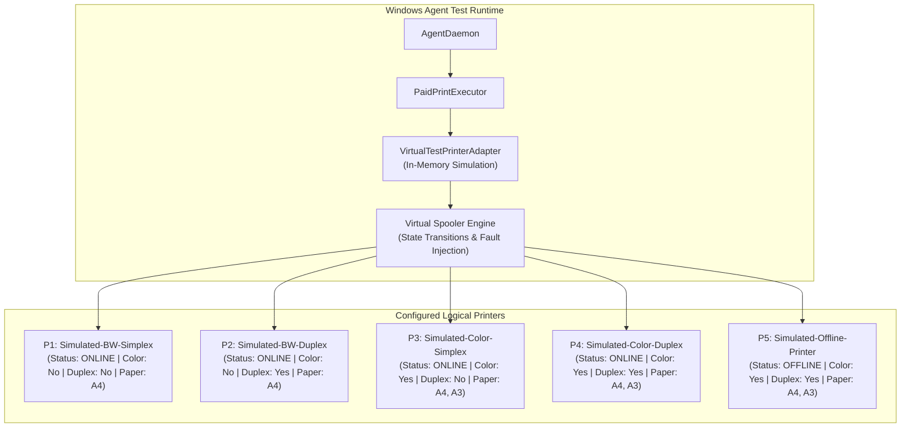

# PRINTGO — PHASE 9: VIRTUAL PRINTER TEST HARNESS & SIMULATION ENVIRONMENT

**Author:** Principal QA Architect & Windows Printing Engineer  
**Methodology:** PONYTAIL Evidence-First Verification  
**Standard:** 100% Isolated Virtualization (Zero Physical Hardware Dependencies)  
**Date:** October 12, 2026

---

## 1. Safety Mandate & Anti-Physical Printing Isolation

### The Inviolable Safety Invariant:

> **ZERO PHYSICAL PRINTING.**  
> Under no circumstances shall any test or execution script connect to a real print queue, query a physical printer via CIM/WMI, probe network port 9100, access the Windows default printer, or invoke SumatraPDF against physical paper.  
> If an un-mocked physical driver is inadvertently detected, the test environment must **FAIL CLOSED IMMEDIATELY**.

---

## 2. Virtual Printer Architecture

To satisfy all Phase 9 requirements, the test harness replaces the physical Windows printing pipeline with a high-fidelity **`VirtualTestPrinterAdapter`** implementing the authoritative `PrinterAdapter` contract (`apps/agent/windows/src/printing/printer-adapter.ts`).



---

## 3. Five-Printer Configuration Manifest

```typescript
export const PHASE_9_VIRTUAL_PRINTERS = [
  {
    summary: {
      id: "P1-BW-Simplex",
      displayName: "Simulated B&W Simplex Printer",
      isDefault: true,
      portName: "VIRT_PORT_P1:",
      driverName: "PrintGo Virtual BW Simplex Driver",
      isVirtual: false, // Flagged false so D1 marks is_production_eligible = 1
      isEligibleForProductionPrint: true,
    },
    capabilities: {
      colour: false,
      duplex: false,
      paperSizes: ["A4"],
    },
    verifiedCapabilities: {
      verified: { bw: 1, color: 0, duplex: 0, a4: 1, a3: 0 },
      requiresReview: false,
    },
    enabledServices: { bw: 1, color: 0, duplex: 0, a4: 1, a3: 0 },
    status: { availability: "ONLINE" as const },
    physicalDeviceId: "DEV_PHYS_01",
  },
  {
    summary: {
      id: "P2-BW-Duplex",
      displayName: "Simulated B&W Duplex Printer",
      isDefault: false,
      portName: "VIRT_PORT_P2:",
      driverName: "PrintGo Virtual BW Duplex Driver",
      isVirtual: false,
      isEligibleForProductionPrint: true,
    },
    capabilities: {
      colour: false,
      duplex: true,
      paperSizes: ["A4"],
    },
    verifiedCapabilities: {
      verified: { bw: 1, color: 0, duplex: 1, a4: 1, a3: 0 },
      requiresReview: false,
    },
    enabledServices: { bw: 1, color: 0, duplex: 1, a4: 1, a3: 0 },
    status: { availability: "ONLINE" as const },
    physicalDeviceId: "DEV_PHYS_02",
  },
  {
    summary: {
      id: "P3-Color-Simplex",
      displayName: "Simulated Color Simplex Printer",
      isDefault: false,
      portName: "VIRT_PORT_P3:",
      driverName: "PrintGo Virtual Color Simplex Driver",
      isVirtual: false,
      isEligibleForProductionPrint: true,
    },
    capabilities: {
      colour: true,
      duplex: false,
      paperSizes: ["A4", "A3"],
    },
    verifiedCapabilities: {
      verified: { bw: 1, color: 1, duplex: 0, a4: 1, a3: 1 },
      requiresReview: false,
    },
    enabledServices: { bw: 1, color: 1, duplex: 0, a4: 1, a3: 1 },
    status: { availability: "ONLINE" as const },
    physicalDeviceId: "DEV_PHYS_03",
  },
  {
    summary: {
      id: "P4-Color-Duplex",
      displayName: "Simulated Color Duplex Printer",
      isDefault: false,
      portName: "VIRT_PORT_P4:",
      driverName: "PrintGo Virtual Color Duplex Driver",
      isVirtual: false,
      isEligibleForProductionPrint: true,
    },
    capabilities: {
      colour: true,
      duplex: true,
      paperSizes: ["A4", "A3"],
    },
    verifiedCapabilities: {
      verified: { bw: 1, color: 1, duplex: 1, a4: 1, a3: 1 },
      requiresReview: false,
    },
    enabledServices: { bw: 1, color: 1, duplex: 1, a4: 1, a3: 1 },
    status: { availability: "ONLINE" as const },
    physicalDeviceId: "DEV_PHYS_04",
  },
  {
    summary: {
      id: "P5-Offline",
      displayName: "Simulated Offline Printer",
      isDefault: false,
      portName: "VIRT_PORT_P5:",
      driverName: "PrintGo Virtual Offline Driver",
      isVirtual: false,
      isEligibleForProductionPrint: true,
    },
    capabilities: {
      colour: true,
      duplex: true,
      paperSizes: ["A4", "A3"],
    },
    verifiedCapabilities: {
      verified: { bw: 1, color: 1, duplex: 1, a4: 1, a3: 1 },
      requiresReview: false,
    },
    enabledServices: { bw: 1, color: 1, duplex: 1, a4: 1, a3: 1 },
    status: {
      availability: "OFFLINE" as const,
      message: "Printer powered off or disconnected",
    },
    physicalDeviceId: "DEV_PHYS_05",
  },
];
```

---

## 4. Virtual Spooler Engine Specifications

The in-memory spooler engine reproduces the full lifecycle of Windows Print Spooler (`winspool.drv`) jobs without touching the OS spooler:

### 1. Spool Job State Progression

Upon receiving `submitPdfJob(submission)`:

1. Validates local PDF exists on disk.
2. Validates print settings against target printer capabilities (throws `UnsupportedPrintSettingError` on invalid requests, e.g. color on P1).
3. Asserts normalized settings string contains mandatory `fit` flag.
4. Generates unique deterministic spool ID: `virt-spool-${Date.now()}-${random}`.
5. Simulates realistic timing lifecycle:
   - `0 ms – 100 ms`: State is `SPOOLING`
   - `100 ms – 400 ms`: State is `PRINTING`
   - `> 400 ms`: State is `COMPLETED_OR_REMOVED`

### 2. Failure & Fault Injection API

The test suite can programmatically inject simulated printer faults:

```typescript
// Fault Injection Primitives for Virtual Adapter
virtualAdapter.setPrinterStatus("P1-BW-Simplex", {
  availability: "BLOCKED",
  message: "Paper Jam",
});
virtualAdapter.setPrinterStatus("P2-BW-Duplex", {
  availability: "OFFLINE",
  message: "USB Disconnected",
});
virtualAdapter.setSimulatedJobStatus(spoolJobId, {
  state: "BLOCKED",
  message: "Out of Paper",
});
virtualAdapter.emitPrinterEvent({
  printerName: "P1-BW-Simplex",
  eventType: "JAM",
});
```

### 3. Immediate Disk Cleanup Verification

The virtual adapter monitors local temporary files:

- Asserts downloaded customer PDF is unlinked immediately upon mock submission.
- Asserts identification sheet PDF is unlinked immediately upon mock submission.

---

## 5. Fail-Safe Execution Guardrail

To ensure tests can run on any development machine (macOS, Linux, Windows) without accidental hardware access, `VirtualTestPrinterAdapter` enforces a strict guardrail:

```typescript
export class VirtualTestPrinterAdapter implements PrinterAdapter {
  constructor() {
    // HARD ENFORCEMENT: Completely prevents physical process spawning
    if (process.env.ALLOW_PHYSICAL_PRINTING === "true") {
      throw new Error(
        "FATAL: Physical printing is strictly prohibited in Phase 9 testing!",
      );
    }
  }
  // All methods operate 100% in-memory with zero child_process or powershell calls.
}
```
